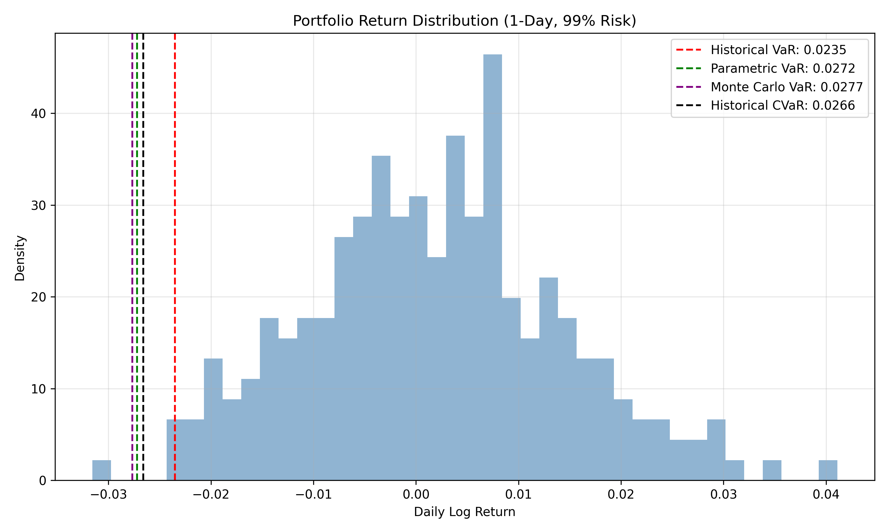

# Monte Carlo VaR & CVaR Risk Engine

## Goal
Implement portfolio risk metrics:
- Historical VaR
- Parametric VaR
- Monte Carlo VaR (GBM baseline)
- CVaR / Expected Shortfall

## Example Output

## Repo layout
- `src/` core code
- `notebooks/` exploration/results
- `tests/` unit tests
- `data/` optional datasets

